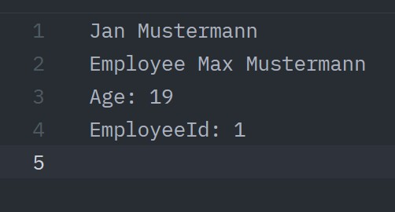

# HelloWorld
Author: Konstantin Hauser <br>
LBS Eibiswald | 2APC

Eine Übung zur Vererbung in java

## Demo



## Vorausetztungen

- Java version 8+
- Eine IDE

## Installation

1. Die Repo mit ```git clone https://github.com/konstantinhauser/HelloWorld.git``` clonen
1. Öffnen in einer IDE

## Verwendung
Technologien im Einsatz:
[![Java][java.com]][java-url]

## License

[MIT](https://choosealicense.com/licenses/mit/)

## Kontakt

Konstantin Hauser (Autor): hauser.konstantin@knapp.com

<!-- MARKDOWN LINKS & IMAGES -->
<!-- https://www.markdownguide.org/basic-syntax/#reference-style-links -->
[java.com]: https://img.shields.io/badge/Java-ED8B00?style=for-the-badge&logo=openjdk&logoColor=white
[java-url]: https://www.java.com/de/
